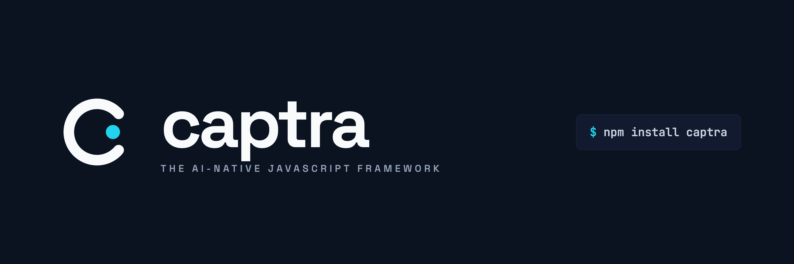

# Captra

Captra is a capability-first framework for type-safe, memory-aware AI applications.

It keeps the application contract small while the runtime handles validation, tools, scoped memory, authorization, approvals, durable run events, and generated UI boundaries.

**Documentation:** [Start here](docs/README.md) · [Mental model](docs/concepts.md) · [State and memory](docs/state-and-memory.md) · [Deployment](docs/deployment.md) · [Roadmap](ROADMAP.md)

```bash
npx create-captra my-app
cd my-app
npm install
npx captra dev
```

The starter is full-stack: Vite + React on port 5173, a Captra Node runtime on port 8787, typed HTTP transport, scoped memory, a local component registry, and a capability test. `npm run build` verifies both browser and server output; `npm test` exercises the contract and memory behavior.

It also includes Captra's accessible startup animation and production SVG mark. The animation respects reduced-motion preferences, can be skipped or replayed, and hands off automatically to the application.

For custom setups, one install exposes the complete framework through explicit runtime-safe entry points:

```ts
import { capability,agent,defineApp } from 'captra'
import { createCaptraClient } from 'captra/client'
import { CapabilityOutput } from 'captra/react'
import { createCaptraHandler } from 'captra/server'
import { createNodeHandler } from 'captra/server/node'
import { createCaptraMcpHandler } from 'captra/mcp'
```

```tsx
export const refund=capability({
  name:'refund',
  input:RefundInput,
  output:RefundResult,
  memory:['user','project'],
  permissions:['refund:create'],
  approval:'required',
  run:refundPayment,
  view:RefundCard,
})
```

Capabilities can call typed tools through their runtime context:

```ts
const lookupCustomer=defineTool({
  name:'customers.lookup',
  description:'Find a customer by email',
  input:z.object({email:z.email()}),
  output:Customer,
  execute:({email})=>crm.customers.find(email),
})

const support=capability({
  // input, output, memory, approval and view omitted
  run:async ({email},ctx)=>ctx.tools.call('customers.lookup',{email}),
})

export default defineApp({
  name:'Support', scopes:['user','project'],
  tools:[lookupCustomer,...builtinTools],
  capabilities:[support], surface:capabilityViews(),
})
```

An agent is a capability whose implementation is a guarded model/tool loop. Its tools are automatically registered with the app:

```ts
export const researcher=agent({
  name:'research', instructions:'Research carefully and cite the evidence.',
  input:ResearchRequest, output:ResearchReport,
  model, tools:[searchDocs,fetchPage],
  budget:{maxSteps:6,maxToolCalls:10,maxTokens:20_000},
  view:ResearchReportCard,
})
```

This preserves one mental model for developers: deterministic capabilities and model-directed agents use the same schemas, memory, tools, approvals, events, workers, and UI boundary.

The same app contract provides end-to-end types to browser and server clients without generating a second schema:

```ts
const client=createCaptraClient<typeof app>({baseUrl:'/api/captra'})
const result=await client.execute('refund',{amount:48})
// capability names, input, and result.value are inferred from app
```

Remote responses contain a small transport-safe capability descriptor rather than runtime functions or validation objects. React resolves the returned view name against an explicit local component registry: `<CapabilityOutput result={result} views={{RefundCard}} />`.

Common agent states can be rendered with accessible, unstyled primitives that expose stable `data-captra` attributes for complete visual control:

```tsx
<CapabilityBoundary
  result={result} pending={pending} error={error}
  views={{RefundCard}} showTrace
  onApprove={approve} onReject={reject}
/>
```

Use `RunStatus`, `ApprovalPanel`, and `EventTimeline` independently when a product needs a custom layout. Labels, empty states, timestamps, approval copy, and CSS classes remain application-controlled.

For a remote backend, one typed hook owns the entire run lifecycle:

```tsx
const refund=useRemoteCapability(client,'refund')

await refund.stream({amount:48})
// refund.result, events, pending, error
// refund.approve(), reject(), cancel(), refreshEvents(), reset()
```

The capability name, input, and output are inferred from the same app contract used by `createCaptraClient`. Streaming trace events update independently before the final structured result arrives.

## Live application state

Captra separates live state from agent memory. State is exact, reactive application data; memory is historical context recalled by relevance. A capability declares which state it reads and which state becomes stale after it succeeds:

```ts
const addTodo=capability({
  name:'todos.add',
  state:{reads:[['todos']],writes:[['todos']]},
  // input, output, run and view omitted
})
```

In React, one hook owns loading, deduplication, subscriptions, errors, and refresh. Successful capabilities automatically invalidate their declared writes and invalidations:

```tsx
const todos=useCaptraState<Todo[]>(['todos'],{load:api.listTodos,staleTime:30_000})
const add=useRemoteCapability(client,'todos.add')
const optimistic=useOptimisticState<Todo[]>(['todos'])

const change=optimistic(current=>[...(current??[]),draft])
const result=await add.run(draft)
if (result) change.commit()
else change.rollback()
```

Use `createState()` with `CaptraStateProvider` to isolate an app, tenant, or test. `dehydrate()`/`hydrate()` support server rendering, while memory and local-storage persistence adapters support longer-lived clients.

### Shared multi-agent state

Shared state uses optimistic versions for normal agent work and short, expiring leases with fencing tokens for critical commits. Model inference happens before the commit, so an LLM never holds a database lock while it thinks:

```ts
const inventory=sharedState<Inventory>({
  key:['inventory',productId],
  adapter:new PostgresSharedStateAdapter(pool,tenantId),
  schema:Inventory,
})

const allocation=await coordinateAgentState({
  state:inventory,
  actor:`agent:${runId}`,
  decide:async snapshot=>planner.allocate(snapshot.value),
  validate:next=>inventoryPolicy.assertValid(next),
  maxConflicts:2,
})
```

Each commit is compare-and-swap: if another worker changed the version, the agent receives the new snapshot and replans. `acquire()`, `renew()`, and `release()` are available for short exclusive sections; monotonically increasing fencing tokens prevent an expired agent from writing after another worker takes over. PostgreSQL state is tenant-scoped and records commits, conflicts, and lease activity in an audit history.

Use the OpenAI Responses API through the provider-neutral model contract:

```ts
import { createOpenAI } from '@captra-ai/openai'

const model=createOpenAI({model:'gpt-5.4'})
```

The adapter supports function calls, response continuation, usage accounting, streaming, cancellation, and bounded retries for rate limits and transient server errors.
Create it only in trusted server code; never expose `OPENAI_API_KEY` in a browser bundle.

Adaptive memory wraps any memory store, including PostgreSQL:

```ts
const memory=new AdaptiveMemoryStore(
  new PostgresMemoryStore(pool),
  createOpenAIEmbeddings({model:'text-embedding-3-small'}),
  {limit:12,minSimilarity:.35,deduplicateSimilarity:.98},
)

await memory.ingest(conversation,{tenantId,scope:'user',ownerId:userId},createMemoryExtractor(model))
```

Recall is tenant- and scope-aware, excludes expired records, ranks candidates by cosine similarity, suppresses near duplicates, and injects only selected memories into agent context.

For persistent vectors across processes and workers, enable the optional `pgvector` adapter:

```ts
await migrateCaptraVectors(pool,1536)

const memory=new PostgresSemanticMemoryStore(
  pool,
  createOpenAIEmbeddings({model:'text-embedding-3-small',dimensions:1536}),
  {dimensions:1536,limit:12,minSimilarity:.35},
)
```

Vector dimensions are validated before writes and searches. Similarity ranking and tenant/scope filtering execute together inside PostgreSQL.

## Resumable agent checkpoints

Agent state is checkpointed before and after every tool call. A retried worker restores the conversation, provider continuation state, budgets, and pending call index:

```ts
const runtime=createRuntime(app,{
  runs:new PostgresRunStore(pool),
  checkpoints:new PostgresCheckpointStore(pool),
})

const replay=await runtime.replay(runId)
```

Completed tool calls are not repeated after recovery. `replay()` returns the durable run, ordered event trace, and checkpoint history for debugging or deterministic inspection.

## Observability and evaluations

Pass a `TelemetryAdapter` to capture run, tool, and model spans plus duration, failure, and token metrics. `InMemoryTelemetry` is included for local inspection and tests.

```ts
const telemetry=new InMemoryTelemetry()
const runtime=createRuntime(app,{telemetry})

const report=await runEvaluation(runtime,cases)
enforceEvaluation(report,{minPassRate:.95,maxFailures:2,maxCostUsd:1,maxP95DurationMs:2_500})

console.log(formatEvaluation(report,'junit'))
```

Evaluation suites support reusable scorers, per-case cost/token/latency limits, aggregate quality gates, and baseline-versus-candidate comparison. `recordModel()` captures provider-neutral model interactions. `replayModel()` returns those responses deterministically during tests, eliminating API cost and model variance from regression suites.
Use `createOpenTelemetryAdapter(tracer,meter)` to export the same signals through an existing OpenTelemetry SDK and exporter.

## Lifecycle hooks

Hooks compose in middleware order: `before*` hooks run in declaration order and `after*` hooks unwind in reverse order. They can transform capability input/output, filter recalled memory, wrap tool input/output, enforce approval policy, observe events, and record capability or tool failures.

```ts
const governance=defineHook({
  name:'governance',
  afterMemoryRecall:records=>records.filter(record=>record.confidence>=.8),
  beforeTool:(name,input,ctx)=>redact(name,input,ctx),
  beforeApproval:({run,decision})=>policy.assertAllowed(run,decision),
  onEvent:event=>audit.write(event),
})
```

Transform and policy hooks fail closed. Observer hooks (`onEvent`, `onError`, and `onToolError`) are failure-isolated and increment `captra.hook.failures` instead of changing the run outcome.

## Integration plugins

Third-party integrations bundle tools and lifecycle hooks behind one explicit, inspectable contract:

```ts
export const crmPlugin=definePlugin({
  name:'@acme/captra-crm', version:'1.0.0',
  tools:[lookupCustomer,updateCustomer],
  hooks:[crmAuditHook],
})

export default defineApp({
  name:'Support', scopes:['user'], capabilities:[support],
  plugins:[crmPlugin], surface:capabilityViews(),
})
```

Plugin order is deterministic: plugin hooks wrap app hooks, and app-local tools may reuse the exact same tool object but cannot silently replace another implementation. Duplicate plugin names and conflicting tool registrations fail during app construction. The compiled manifest exposes plugin names and versions without exposing runtime code or credentials.

## Runtime primitives

- `capability()` — the typed user-facing action contract
- `defineTool()` — a reusable, permission-aware integration function
- `definePlugin()` — a versioned bundle of integration tools and lifecycle hooks
- `defineApp()` — the registry and deployment boundary
- `createRuntime()` — validated execution, approvals, cancellation, events, and idempotency
- `MemoryAdapter` — organization, user, project, session, and task memory
- `ModelAdapter` — provider-neutral generation and streaming
- `createStructuredGenerator()` — schema-validated model output
- `createModelPlanner()` — natural-language capability selection
- `createModelFallback()` — retries, deadlines, circuit breaking, sticky provider failover, and aggregate usage
- `agent()` — budgeted multi-step model/tool execution as a typed capability
- `builtinTools` — scoped remember, recall, and forget operations
- `createFetchJsonTool()` — opt-in JSON HTTP access with exact outbound-origin, header, redirect, and response-size policy
- `useCaptra()` / `useCapability()` — React orchestration hooks
- `chat()` / `useChat()` — governed streaming chat with memory, budgets, cancellation, approvals, and reconnect

## Durable PostgreSQL runtime

Captra accepts any `pg`-compatible client exposing `query(text, values)`, so the adapter is not tied to a specific Postgres vendor:

```ts
import { createRuntime } from '@captra-ai/core'
import { migrateCaptra, PostgresMemoryStore, PostgresRunStore } from '@captra-ai/postgres'

await migrateCaptra(pool)

const runtime=createRuntime(app,{
  runs:new PostgresRunStore(pool),
  memory:new PostgresMemoryStore(pool),
  authorize:async (identity,permissions)=>policy.allows(identity,permissions),
})
```

The schema includes tenant-scoped memory indexes, durable event history, and a database-enforced idempotency key. Run event sequence allocation is serialized on the run row to remain safe under concurrent workers.

CI runs the adapter against PostgreSQL 16 with `pgvector`. The integration suite verifies migrations, concurrent idempotent run creation, serialized events and checkpoints, tenant and expiry isolation, vector ranking and deduplication, and exclusive queue leases. Locally, set `CAPTRA_POSTGRES_URL` to opt into the same suite.

Background runs use leased queue jobs, allowing another worker to recover work after a crashed worker's lease expires:

```ts
const queue=new PostgresWorkQueue(pool)
await runtime.enqueue({capability:'build-report',input,identity},queue)

const worker=createWorker({runtime,queue,workerId:process.env.WORKER_ID})
await worker.runOnce()
```

## Packages

- `captra` — recommended umbrella package with explicit client, React, server, Node, PostgreSQL, and OpenAI entry points
- `@captra-ai/core` — contracts, runtime, durable runs, memory, events, planners, manifests
- `@captra-ai/state` — typed live state, subscriptions, deduplicated loading, optimistic updates, persistence
- `@captra-ai/client` — typed HTTP client and live event streaming
- `@captra-ai/postgres` — durable run, event, and multi-level memory storage
- `@captra-ai/openai` — OpenAI Responses API generation, tools, continuation, usage, and streaming
- `@captra-ai/react` — hooks and safe capability-view rendering
- `@captra-ai/devtools` — unstyled run, event, checkpoint, and agent-metric inspection
- `@captra-ai/server` — Web Standard backend handler and Node HTTP adapter
- `@captra-ai/cli` — create, dev, build, test, and inspect commands
- `create-captra` — project scaffolding

## Commands

```bash
captra create my-app
captra add capability summarize-notes
captra add tool search-docs
captra add plugin audit-kit
captra doctor
captra dev my-app
captra build my-app
captra test my-app
captra inspect my-app
```

The generators create typed, buildable framework contracts and tell you exactly what to register in `src/captra.app.ts`. `captra doctor` checks the project setup. `captra secrets` follows browser imports and fails on server-only modules, server environment access, public secret variables, or credential-like literals without printing secret values. Generated builds run it before and after bundling.

The runtime is model- and backend-independent. Implement `PlannerAdapter`, `MemoryAdapter`, and `RunStore` to connect an existing agent runtime and infrastructure.

## Backend boundary

`createCaptraHandler()` uses Web Standard `Request` and `Response`, so the same handler mounts in Next.js route handlers, Bun, Deno, Cloudflare Workers, and modern Node servers. Production controls are configured in one place:

```ts
const handler=createCaptraHandler(runtime,{
  basePath:'/api/captra',
  auth:resolveIdentity,
  maxBodyBytes:1_000_000,
  cors:{origins:['https://app.example.com'],credentials:true},
})

export const GET=handler
export const POST=handler
export const OPTIONS=handler
```

Node HTTP, Express-compatible request/response servers, and frameworks built on them can use the included adapter:

```ts
import { createServer } from 'node:http'
import { createNodeHandler } from '@captra-ai/server/node'

createServer(createNodeHandler(handler)).listen(8787)
```

Framework-native mounts are intentionally tiny and dependency-free:

```ts
// Next.js app/api/captra/[[...path]]/route.ts
export const {GET,POST,OPTIONS}=createNextRoute(handler)

// Hono / Cloudflare Workers
app.all('/api/captra/*',createHonoHandler(handler))

// Express — preserves originalUrl when mounted
app.use('/api/captra',createExpressMiddleware(handler))
```

Import Express support from `captra/server/express`. Next.js and Hono helpers live in `captra/server`, keeping edge bundles free from Node modules.

Routes are matched exactly beneath the mount path. The server negotiates the Captra protocol, attaches request IDs, bounds request bodies, answers CORS preflights before authentication, and returns stable error codes with appropriate HTTP statuses.

## Releases

Every library package is compiled to ESM JavaScript with TypeScript declarations, declaration maps, source maps, explicit export maps, and restricted npm file lists. Changesets coordinates framework versions and the manual release workflow opens version PRs before publishing with npm provenance.

Publishing is intentionally disabled by default. Before running the workflow, a repository owner must enable GitHub Actions to create pull requests and configure either npm trusted publishing or `NPM_TOKEN`. Then run **Release** from GitHub Actions with the confirmation input. Normal pushes run CI only, so missing publication credentials never produce a misleading red build.
